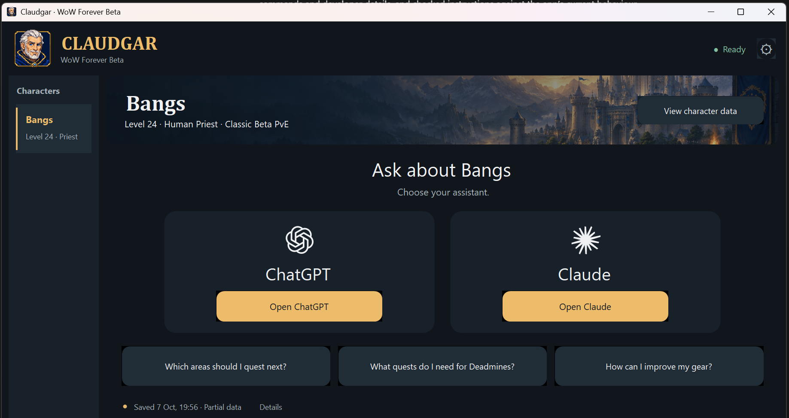

# Ask Claudgar

Get AI advice based on your WoW Forever character's quests, talents, inventory,
and gear. Claudgar installs a game addon and connects your saved character data
to ChatGPT or Claude.

**You'll need:** Windows 10/11 (64-bit), WoW Forever Beta, and the
[ChatGPT desktop app](https://learn.chatgpt.com/docs/quickstart) (Work mode)
or [Claude Desktop](https://claude.com/download).

## Get started

1. **Install and open your chosen chat app** once before setting up Claudgar.
2. **Download [Claudgar](https://github.com/RichardBangs/Claudgar/releases)**
   and run `Claudgar.exe`. Choose your game folder if prompted; the addon and
   chat connections are set up automatically.
3. **Enable Claudgar in the game's AddOns menu** and log into your character.
   Click Claudgar's face beside the minimap while out of combat to refresh your
   data and reload the game UI. You can also save by typing `/reload` or logging out.
4. **Restart your chat app.**
5. **Ask:** “Use Claudgar to check my character's gear.” Include your character
   name if you have several characters.

## Everyday use

**Keep Claudgar running while you chat.** It reads your last saved data.
After changing gear, quests, or talents, save again using the minimap face,
`/reload`, or logout, then ask the chatbot to check again.

Try asking where to quest next, which Deadmines quests you still need, or how
to improve your gear. Claudgar also has suggested questions you can copy.

**On your phone:** open **Ask from your phone** in Claudgar's settings for
instructions. Keep your PC awake and online, with Claudgar and your chat app running.

## Settings and help

- **Background running:** closing the window keeps Claudgar in the system tray.
  Right-click its tray icon and choose **Exit Claudgar** to stop it.
- **Windows startup:** enabled by default. Turn off **Launch on startup** in
  settings if you prefer.
- **Updates:** downloaded automatically. Click **Update available** to install
  and restart, or let it install next time Claudgar starts. After an addon update,
  reload the game UI or log out and back in.
- **Missing or old character data?** Check the addon is enabled and the correct
  game folder is selected, then save again.
- **Chat can't connect?** Keep Claudgar running, choose **Repair setup** in
  settings, then fully quit and reopen your chat app. In ChatGPT/Codex you can
  also restart the connection under **Settings → MCP servers**. Restarting
  Claudgar alone does not reload tools in an already-open chat. Open **Connection
  details** to check setup status: **configured** means the connection is saved,
  not that your current chat has loaded it. Claudgar checks for a missing or
  changed Codex connection every 30 seconds and offers repair without silently
  replacing your settings. Alternatively, use **Copy JSON** in the character data view
  and paste it into your chat.
- **Codex reports a corrupt config?** Preserve the broken file and restore a
  known-good backup first. Claudgar refuses files containing NUL bytes and
  backs up the config whenever it changes its connection.
  After restoring an older config, run **Repair setup** and restart your chat app
  so the Claudgar connection is included again.

## Privacy and support

Claudgar reads saved data; it does not control gameplay or ask for Battle.net
credentials. Character data requested by your chat app is processed by that
AI provider. Remove private information before sharing exports.

[Report a problem](https://github.com/RichardBangs/Claudgar/issues) with your
Claudgar version and the exact error message. Licensed under [MIT](LICENSE).
